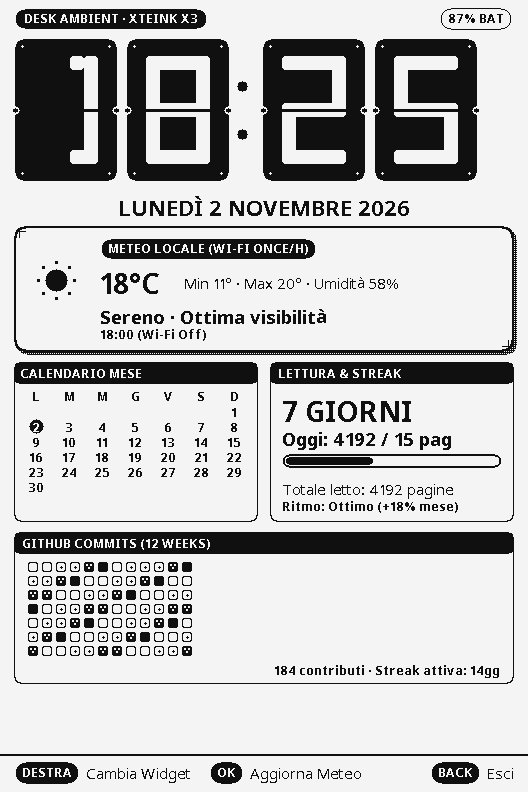
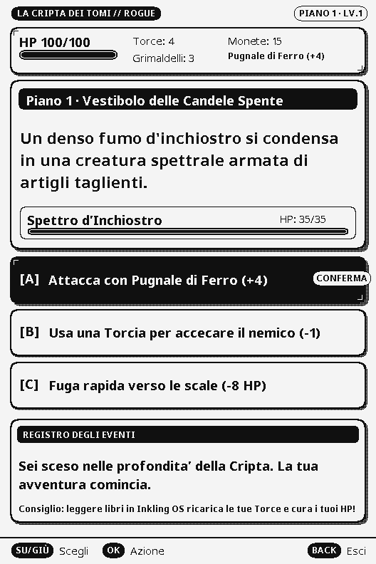
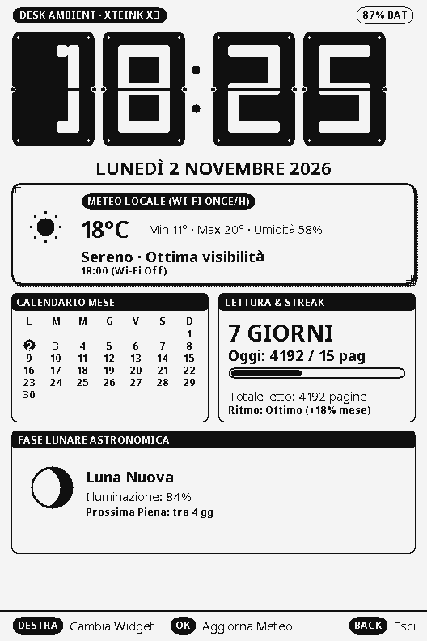
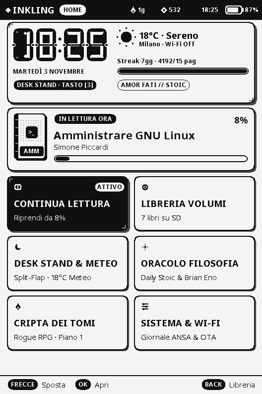
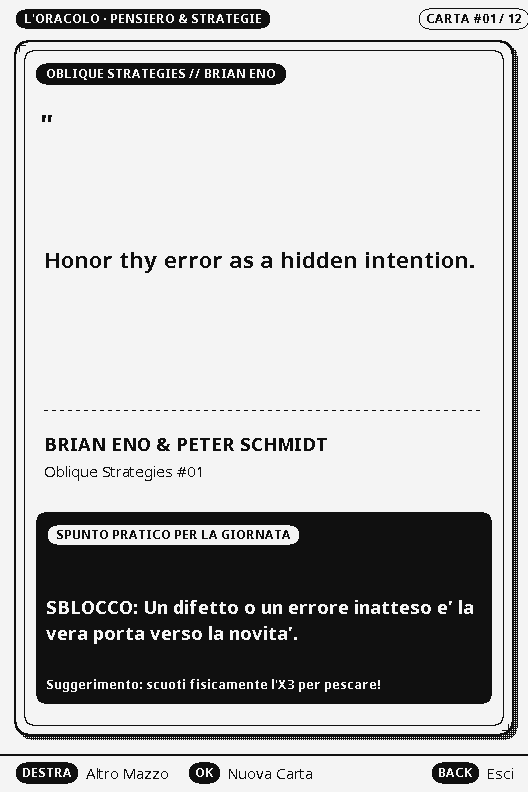
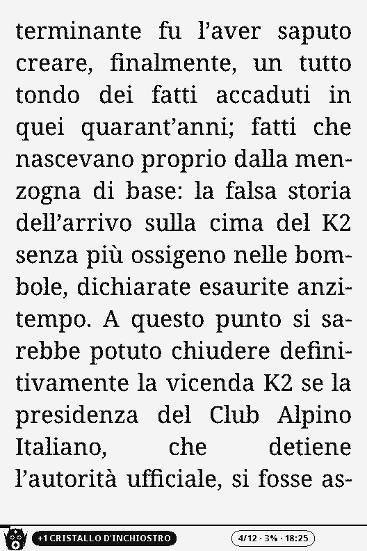
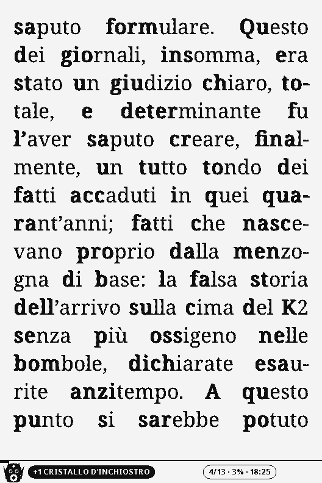
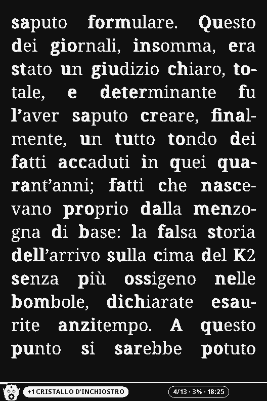
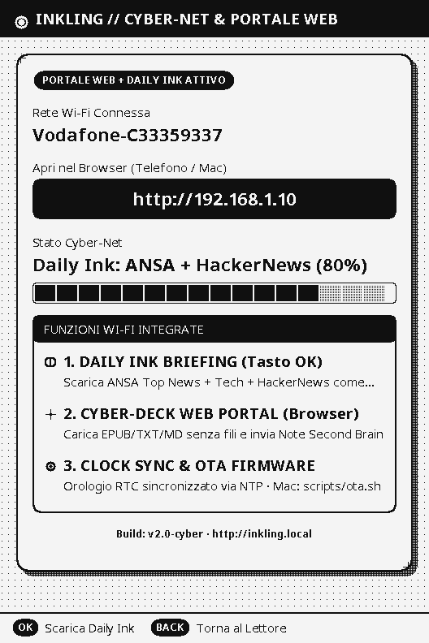
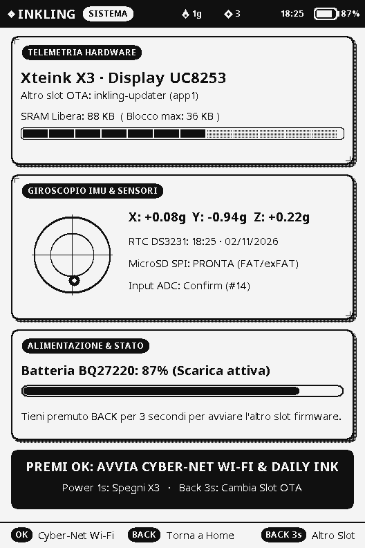

# INKLING OS v2.1 — Cyber-Editorial E-Ink Firmware per Xteink X3

<p align="center">
  
  
  
</p>

**Inkling OS v2.1** è un sistema operativo E-Ink completo, ultra-ottimizzato e dal design *Cyber-Editorial / Teenage Engineering / Braun*, progettato su misura per l'e-reader tascabile **Xteink X3** (`ESP32-C3` RISC-V 160 MHz single-core senza PSRAM, pannello E-Ink `UC8253` 792×528 1-bit, giroscopio IMU a 3 assi, RTC `PCF8563` e microSD).

---

## Galleria Schermate (Rendering 1:1 da Framebuffer 528×792)

### Cyber-Desk Stand, Meteo & Home Command Center
| Desk Stand (Orologio Split-Flap + GitHub) | Desk Stand (Fase Lunare Astronomica) | Home Command Center Rinnovata |
| :---: | :---: | :---: |
|  |  |  |

### L'Oracolo Filosofico, Oblique Strategies & Micro-RPG
| Daily Stoic (Marco Aurelio / Seneca) | Oblique Strategies (Brian Eno) | La Cripta dei Tomi (Micro-RPG) |
| :---: | :---: | :---: |
|  |  |  |

### Motore di Lettura Editoriale, Bionic Focus & Modalità Notte
| Prosa Editoriale (Noto Serif + Sillabazione IT) | Lettura Veloce (Bionic Focus Reading) | Modalità Notte (Inversione E-Ink 1-Bit) |
| :---: | :---: | :---: |
|  |  |  |

### Cyber-Net Wi-Fi Hub 2.0, Daily Ink Briefing & Telemetria
| Cyber-Net Hub & Portale Web | Daily Ink Briefing (ANSA + HackerNews) | Telemetria & Giroscopio IMU |
| :---: | :---: | :---: |
|  |  |  |

---

## Caratteristiche Principali

### 1. Cyber-Desk Ambient Stand (Orologio Meccanico Split-Flap & Meteo)
- **Cifre Split-Flap Meccaniche Giganti (`18 : 25`)**: renderizzate in vettoriale procedurale 1-bit con fessura orizzontale centrale, viti angolari e cerniere laterali.
- **Meteo Locale**: temperatura attuale, min/max, umidità, icone 1-bit (*Sole, Nuvole, Pioggia, Tempesta, Neve, Nebbia*) e stato sincronizzazione oraria.
- **Bento Box Laterale**:
  - **Mini-Calendario**: mese corrente con giorno odierno cerchiato a contrasto inverso.
  - **Reading Streak**: streak di giorni consecutivi, pagine odierne e barra di avanzamento obiettivo.
  - **Widget Configurabile (Tasto Destra)**:
    - *Modalità A*: **GitHub Contribution Heatmap** (matrice 7×12 a 4 livelli di dither 1-bit).
    * *Modalità B*: **Fase Lunare Astronomica** con calcolo del terminatore e percentuale illuminata.

### 2. L'Oracolo & Oblique Strategies (Daily Stoic & Brian Eno)
- **Due Mazzi Integrati in Flash (Zero RAM Dinamica)**:
  - **Daily Stoic**: aforismi selezionati (*Marco Aurelio, Seneca, Epitteto, Calvino, Borges, Nietzsche*) con box di sfida/azione pratica per la giornata.
  - **Oblique Strategies (Brian Eno & Peter Schmidt)**: il celebre mazzo per rompere i blocchi mentali e stimolare il pensiero laterale.
- **Scuoti fisicamente l'Xteink X3 (IMU)**: l'accelerometro a 3 assi rileva lo scuotimento ed estrae istantaneamente una nuova carta rimescolata!

### 3. La Cripta dei Tomi (Micro-RPG Testuale Procedurale)
- Dungeon crawler a turni 100% testuale a scelte multiple, studiato specificamente per il refresh dell'E-Ink:
  - **Stanze & Incontri Procedurali**: Vestiboli, Biblioteche Proibite, Cripte, Santuari e Forzieri.
  - **Risorse & Combattimento**: Salute (HP), Torce, Grimaldelli, Monete, XP, Livello e Armi speciali, con registro eventi testuale.
  - **Sinergia con i tuoi Libri**: ogni pagina letta in Inkling OS ricarica le tue Torce e cura i tuoi HP nel gioco!

### 4. Connessione Wi-Fi Multi-Rete Intelligente
- **Scansione Attiva dell'Etere (Air Scan)**: rileva automaticamente quale delle tue reti domestiche a 2.4 GHz è in portata e si aggancia a quella con segnale migliore.
- **Fallback a Cascata**: se cambi casa o ti sposti, prova in sequenza le reti configurate.
- **Configurazione Multi-Rete (`/.inkling/wifi.txt`)**: supporta fino a 8 reti memorizzate sulla microSD.

### 5. Studio Tipografico & Motore di Lettura Editoriale
- **4 Famiglie di Font in Flash (Zero RAM)**:
  - **Noto Serif** *(Default — ad alto contrasto e leggibilità su E-Ink 250 PPI)*
  - **Noto Sans** *(Sans-serif pulito e moderno)*
  - **Alegreya** *(Umanistico letterario premiato)*
  - **OpenDyslexic** *(Alta accessibilità anti-affaticamento)*
- **8 Taglie Tipografiche Calibrate (`30 px .. 66 px`)**: calibrate sull'altezza `em` reale del pannello X3 (`XS`, `S`, `M-`, `Medio 42px`, `Grande 46px`, `XL 52px`, `XXL 58px`, `MAX 66px`).
- **Lettura Veloce (Bionic Focus Reading)**: evidenzia in grassetto sintetico multi-strike il primo ~45% di ogni parola per guidare le fissazioni oculari e raddoppiare la velocità di lettura.
- **Sillabazione Automatica Italiana & Inglese**: dizionario con **355 pattern sillabici di Liang per l'italiano** (`hyph_it.h`) e dizionario inglese US (`hyph_en_us.h`) per una giustificazione editoriale senza fiumi bianchi.
- **5 Preset di Spaziatura & Margini + Modalità Notte**: `Classico (102%)`, `Compatto (92%)`, `Arioso (116%)`, `Zen Ampio (128%)`, `Focus Largo`, più inversione E-Ink 1-bit completa.

### 2. Kuro-Ink: Compagno Evolutivo (Cyber-Tamagotchi)
- **5 Stadi Evolutivi**: *Spora d'Inchiostro* → *Goccia Senziente* → *Glifo Vivente* → *Custode del Tomo* → *Arconte Astrale*.
- **4 Archetipi Dinamici**: *Saggio*, *Vorace*, *Notturno*, *Errante* (determinati dal tuo stile e dagli orari di lettura).
- **Economia dei Cristalli d'Inchiostro**: guadagna `+1 Cristallo` ogni 10 pagine lette, `+3 Cristalli` a fine capitolo e `+15 Cristalli` a fine libro.
- **Interazione con Giroscopio IMU & Lampada Notturna**: scuoti fisicamente l'Xteink X3 per interagire con Kuro-Ink o accendi la **Lampada Astrale** per invertire l'habitat in tema notturno stellato.
- **Migrazione Automatica da CrossPet**: importa automaticamente livello, XP, pagine lette e streak da `/.crosspoint/pet/pet.json`.

### 3. Hacker Matrix: Breach (Cyberpunk Neural Puzzle)
- Gioco tattico originale 1-bit su griglia neurale `6×6` accessibile dal Santuario o dalla Libreria:
  - Infiltrati nella matrice con l'avatar di Kuro-Ink, raccogli tutti i **Data-Core (`CORE`)**, disattiva i **Firewall Laser (`LASER`)** tramite gli **Switch (`SW`)** ed evita le sentinelle **`ICE`** che ti danno la caccia a ogni turno.
  - **Onda d'Urto EMP**: premi `OK` oppure **scuoti fisicamente l'Xteink X3** (rilevato dal giroscopio IMU!) per scatenare un impulso elettromagnetico che stordisce tutte le sentinelle `ICE` per 3 turni e riduce il `TRACE %`.
  - Ogni sotto-rete violata premia Kuro-Ink con **+1 Cristallo d'Inchiostro e XP reali**.

### 4. Cyber-Net Wi-Fi Hub 2.0: Daily Ink Briefing & Portale Web
- **Daily Ink Briefing (Tasto `OK` in modalità Wi-Fi)**:
  - Scarica via HTTPS le ultime notizie da **ANSA Prima Pagina Italia**, **ANSA Tecnologia & Scienza** e **Hacker News (Silicon Valley Radar)**, pulisce HTML/CDATA e genera sulla microSD il quotidiano **`Daily Ink Briefing - Redazione Cyber-Net.md`** pronto da leggere offline con Bionic Reading.
- **Portale Web "Cyber-Deck" (`http://inkling.local` / `http://192.168.1.10`)**:
  - **Upload Libri Wireless**: carica file `.epub`, `.txt`, `.md` dallo smartphone o dal Mac direttamente sulla microSD senza mai estrarre la scheda.
  - **Send to Xteink (Second Brain)**: incolla qualsiasi articolo web, riassunto o nota Markdown dal browser e invialo come libro formattato all'X3.
  - **Gestione Libreria SD & Sync NTP**: apri o elimina libri da remoto e sincronizza automaticamente l'orologio hardware `PCF8563` via NTP sul fuso orario italiano (`CET/CEST`).

### 5. Ottimizzazione Estrema ("Missile Mode" & Smart Auto-Gear)
- **Smart Dynamic Clock (`160 MHz` ↔ `80 MHz`)**: scala istantaneamente a `160 MHz` a ogni pressione tasto per calcolare il layout e sfogliare le pagine in pochi millisecondi, e scende automaticamente a `80 MHz` dopo 3 secondi di lettura passiva (riducendo del >55% il consumo della CPU durante la lettura).
- **Bus SPI Display a `20 MHz` (2× default) + Custom 13-Frame Turbo LUT**: riduce di oltre il 32% il tempo fisico di refresh del controller `UC8253`.
- **1-Bit Direct Framebuffer Blitter (`CyberCanvas`)**: disegna card, griglie, barre e testo operando su parole a 32-bit direttamente nel framebuffer e aggiorna **solo la fascia dei pixel modificati** quando muovi il cursore nei menu.
- **Architettura Dual-Slot OTA Sicura**: il Lettore (`x3`) vive in uno slot OTA e incorpora nella propria Flash il binario di `Cyber-Net Hub 2.0` (`x3-updater`), aggiornando automaticamente il secondo slot al primo avvio del Wi-Fi e garantendo il rollback automatico in caso di errori.

---

## Compilazione, Simulatore Desktop & Installazione

### 1. Compilare il Firmware (PlatformIO)
```sh
pio run -e x3-updater
cp .pio/build/x3-updater/firmware.bin assets/updater.bin
pio run -e x3
```

### 2. Aggiornamento Wireless via Wi-Fi (`scripts/ota.sh`)
Configura sulla microSD il file `/.inkling/wifi.txt`:
```ini
ssid=NOME_RETE_WIFI_2.4GHZ
password=PASSWORD_WIFI
token=UN_TOKEN_SEGRETO
```
Salva lo stesso `token` nel file `.ota-token` nella root del repository sul Mac, avvia **Cyber-Net Wi-Fi** sull'X3 (`Sistema -> OK` o `Libreria -> Cyber-Net Wi-Fi & Daily Ink`) e lancia:
```sh
INKLING_HOST=192.168.1.10 ./scripts/ota.sh
```

### 3. Installazione da MicroSD (Senza Cavo e Senza Wi-Fi)
Copia `.pio/build/x3/firmware.bin` nella root della microSD con il nome `/inkling.bin` e accendi l'Xteink X3: il dispositivo installerà automaticamente l'aggiornamento e rinominerà il file in `/inkling.bin.installed`.

### 4. Simulatore Desktop macOS / Linux (`inkling-sim`)
Il simulatore esegue esattamente lo stesso codice `InklingCore` + `FreeInkBook` del dispositivo ed esporta ogni schermata come PNG 1-bit `528×792`:
```sh
cmake -S sim -B build/sim
cmake --build build/sim
./build/sim/inkling-sim <cartella-sd> <cartella-output-png>
```
